# Reporte · CloudOps Dashboard SPA

Documentación de las 5 dimensiones del Diseño de Interacción y capturas de los estados de cada control en modo claro y oscuro.

- [1. Las 5 dimensiones del Diseño de Interacción](#1-las-5-dimensiones-del-diseño-de-interacción)
- [2. Estados de los controles](#2-estados-de-los-controles)

---

## 1. Las 5 dimensiones del Diseño de Interacción

Este documento describe cómo se aplica cada dimensión del Diseño de Interacción (IxD) en el Dashboard SPA y en qué archivos se implementa. Los prototipos de referencia están en Figma (páginas **Prototipo** y **Prototipo móvil**).

---

### 1D · Palabras

Redacción clara y concisa en etiquetas, microcopia de botones y mensajes informativos o de error.

| Dónde | Qué se hizo |
| --- | --- |
| Botones (`src/components/overlays/*.jsx`, `src/views/*.jsx`) | Verbos de acción con el objeto concreto: «Guardar cambios», «Reiniciar instancia», «Terminar instancia», «Ver detalle», «Ver todas las alertas». |
| Diálogo de confirmación (`ConfirmModal.jsx`) | El título es una pregunta con el objeto concreto («¿Terminar la instancia api-pagos-03?»). La descripción explica que es irreversible y la lista enumera las consecuencias. |
| Validación del formulario (`Drawer.jsx` → `validate`) | Los errores dicen qué escribir, no solo qué está mal: «Escribe un número entero mayor o igual a 1.», «Debe ser mayor o igual que las réplicas mínimas.», «Elige hoy o una fecha posterior.» |
| Ayudas de campo | «Se notifica cuando se supera durante 5 min.», «Sin fecha, se aplican en el siguiente despliegue.», «✓ El nombre coincide». |
| Notificaciones (`App.jsx`) | Estado y resultado: «Terminando api-pagos-03…» → «api-pagos-03 terminada · La facturación de esta instancia se detuvo.» |
| Estados vacíos | «No hay instancias que coincidan con los filtros.», «Sin alertas activas.» |

### 2D · Representaciones visuales

Iconografía clara y consistente, jerarquía tipográfica legible y paleta funcional.

- **Iconografía** (`src/components/ui/Icon.jsx`): un solo set de íconos de trazo de 24 × 24 y 2 px, los mismos de los componentes «Ícono/…» de Figma. Los íconos decorativos llevan `aria-hidden`.
- **Jerarquía tipográfica** (`src/styles/base.css`): Inter. Título de vista de 22/26 px en negrita, encabezados de tarjeta de 15 px seminegrita, cuerpo de 13–15 px y metadatos de 11–12 px en color atenuado.
- **Paleta funcional** (`src/styles/tokens.css`): los colores tienen un significado fijo. `--crit` indica crítico o destructivo, `--warn` advertencia, `--ok` correcto y `--accent` acción principal o elemento activo. Los estados siempre llevan texto («Crítico», «Advertencia») además del color.
- **Datos** (`LineChart.jsx`, `KpiCard.jsx`): KPIs con mini gráfico, series de tiempo con línea de umbral punteada y marcador de deploy, y barras apiladas por región.

### 3D · Objetos físicos

Zonas de toque de tamaño adecuado (mínimo 44 × 44 px) en smartphone y precisión para el mouse en escritorio.

- `--tap: 44px` (`tokens.css`) es la altura y el ancho mínimos de botones, enlaces de navegación, campos, pestañas y botones de ícono.
- El interruptor mide 44 × 26 px visibles y suma un área táctil invisible de 44 px de alto (`.switch::before`).
- En móvil, los botones del diálogo se apilan a ancho completo con 48 px de alto. El drawer sale desde abajo, al alcance del pulgar.
- En escritorio con puntero preciso (`@media (min-width: 1024px) and (pointer: fine)`) los controles se compactan a 36–40 px. Además hay hover en tarjetas, filas y botones, y el atajo de teclado Ctrl/⌘ K.

### 4D · Tiempo

Transiciones y microinteracciones de duración controlada (200–350 ms) y spinners durante la carga.

- Tokens de duración: `--dur-fast: 200ms` (botones, campos, hover), `--dur-base: 250ms` (tarjetas, modal, scrim) y `--dur-slow: 350ms` (sidebar, drawer, toasts).
- **Microinteracciones**: las tarjetas se elevan en hover (`.card-interactive`), los botones tienen transición de color y escala al pulsar, y el modal anima su apertura y cierre (`modal-in` / `modal-out`).
- **Estado Loading en todos los controles**: spinner, `aria-busy` y control bloqueado mientras dura la operación. Se usa en «Guardar cambios», en la confirmación del diálogo y en los campos del formulario mientras se guarda.

  | Control | Archivo | Cómo se ve en Loading |
  | --- | --- | --- |
  | Botón y enlace con aspecto de botón | `Button.jsx` | Spinner en lugar del ícono; conserva el color de la variante |
  | Botón de ícono | `IconButton.jsx` | Spinner en lugar del ícono |
  | Campo de texto, área de texto, fecha y select | `TextField.jsx`, `TextArea.jsx`, `DateField.jsx`, `Select.jsx` | Spinner a la derecha; texto atenuado; no se puede editar |
  | Interruptor | `Switch.jsx` | Spinner dentro de la perilla |
  | Opción segmentada | `Segmented.jsx` | Spinner antes de la etiqueta |
  | Pestaña | `InstanceDetail.jsx` | Spinner antes de la etiqueta |
  | Elemento de navegación | `Sidebar.jsx` | Spinner en lugar del ícono |
  | Búsqueda | `Header.jsx` | Spinner en lugar de la lupa; sin atajo visible |
  | Toggle de modo oscuro | `Header.jsx` | Spinner en lugar del sol o la luna |
- **Procesos largos**: la notificación «Terminando…» muestra una barra de progreso de 2,5 s antes del estado final.
- **Tiempo real**: el indicador «En vivo · hace N s» cuenta los segundos desde la última actualización (ciclo de 30 s).
- Con `prefers-reduced-motion` las transiciones se reducen al mínimo. El spinner se mantiene, más lento, porque comunica estado.

### 5D · Comportamiento

Reglas lógicas del sistema ante clics y atajos de teclado, y consistencia operativa.

| Regla | Implementación |
| --- | --- |
| **Escape** cierra la capa superior: modal → drawer → menú lateral | `src/hooks/useFocusTrap.js` (pila de capas) |
| El foco queda atrapado en la capa abierta y vuelve al elemento que la abrió | `useFocusTrap.js` |
| Al abrir el diálogo, el foco inicial va a «Cancelar», la opción segura | `ConfirmModal.jsx` |
| Un clic en el fondo oscurecido cierra el menú, el drawer o el diálogo (salvo mientras se ejecuta una acción) | `Sidebar.jsx`, `Drawer.jsx`, `ConfirmModal.jsx` |
| Las acciones destructivas siempre pasan por confirmación. «Terminar» exige escribir el nombre exacto de la instancia | `ConfirmModal.jsx` |
| «Guardar cambios» se habilita solo si hay cambios válidos. «Descartar» restaura los valores | `Drawer.jsx` |
| **Ctrl/⌘ K** enfoca la búsqueda global; Enter lleva a Instancias filtradas | `Header.jsx` |
| Flechas ← → cambian de pestaña en el detalle | `InstanceDetail.jsx` |
| Al navegar, se cierran el menú y el drawer, se actualiza el título del documento y el foco pasa al encabezado de la vista | `App.jsx` |
| ¿Dónde estoy? / ¿De dónde vengo? / ¿A dónde puedo ir? | Elemento activo (`aria-current`) en la sidebar, migas de pan, enlace «← Instancias» en el detalle y contador de alertas en el menú y en la campana |
| El tema sigue al sistema hasta que se usa el toggle; la elección se guarda | `src/hooks/useTheme.js`, `index.html` |

---

## 2. Estados de los controles

Cada control se capturó aislado en la aplicación real a 2× en sus cinco estados: Default, Hover, Focus, Disabled y Loading.
Hover y Focus se forzaron con las pseudoclases del navegador; Disabled y Loading, con los estados que define cada componente.

### Modo claro

<table>
  <thead><tr><th>Control</th><th>Default</th><th>Hover</th><th>Focus</th><th>Disabled</th><th>Loading</th></tr></thead>
  <tbody>
    <tr><th>Botón primario</th><td>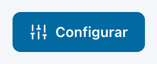</td><td>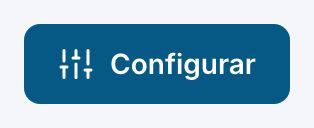</td><td>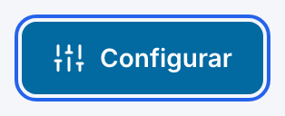</td><td>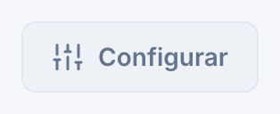</td><td>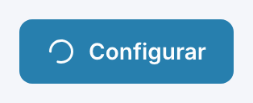</td></tr>
    <tr><th>Botón secundario</th><td>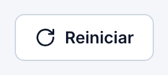</td><td>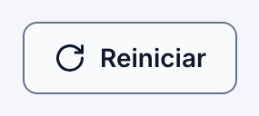</td><td>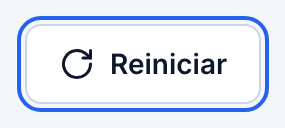</td><td>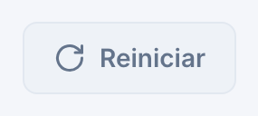</td><td>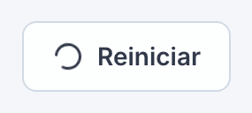</td></tr>
    <tr><th>Botón fantasma</th><td>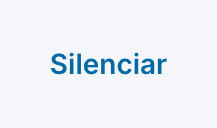</td><td></td><td>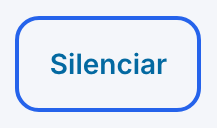</td><td>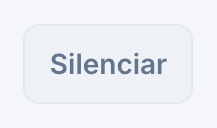</td><td>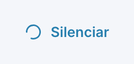</td></tr>
    <tr><th>Botón de peligro</th><td>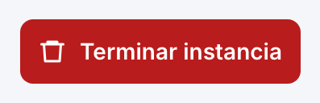</td><td>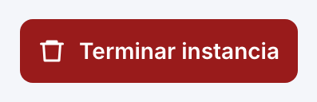</td><td>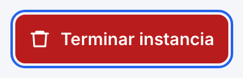</td><td>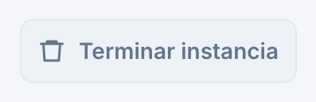</td><td>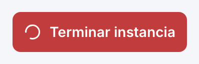</td></tr>
    <tr><th>Botón de peligro (contorno)</th><td>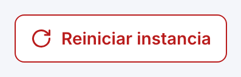</td><td>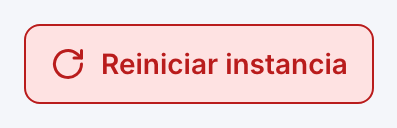</td><td>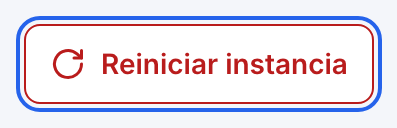</td><td>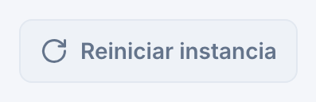</td><td>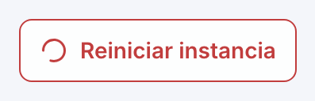</td></tr>
    <tr><th>Enlace con aspecto de botón</th><td>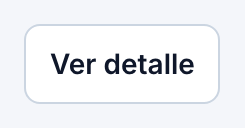</td><td>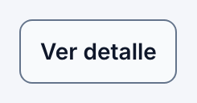</td><td>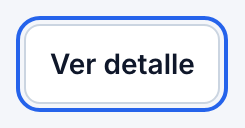</td><td>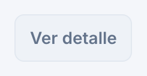</td><td>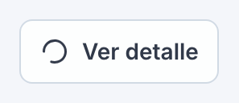</td></tr>
    <tr><th>Botón de ícono</th><td>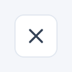</td><td>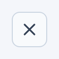</td><td>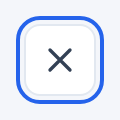</td><td>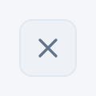</td><td>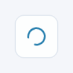</td></tr>
    <tr><th>Campo de texto</th><td>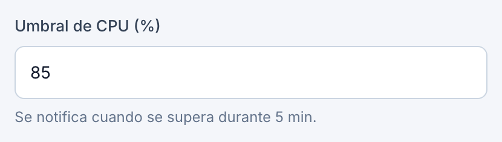</td><td>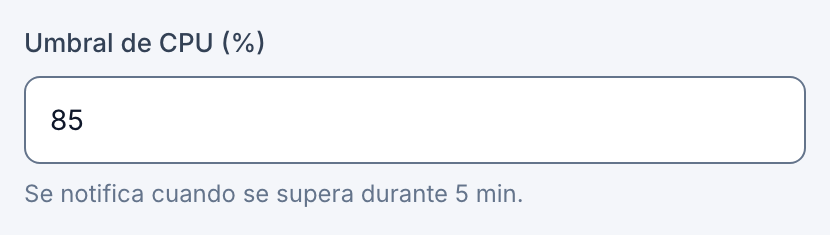</td><td>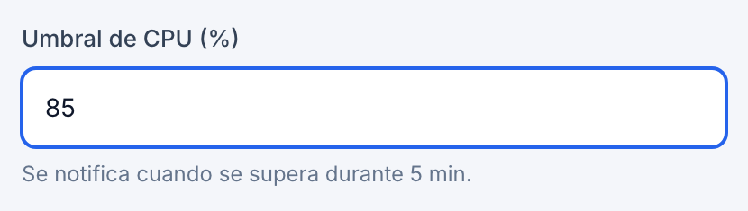</td><td>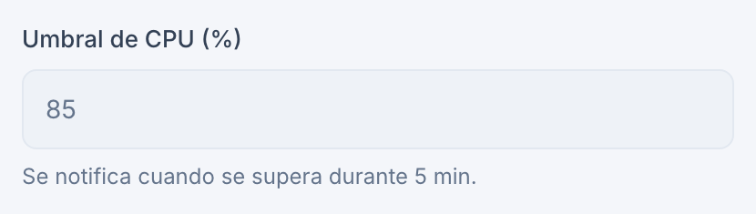</td><td>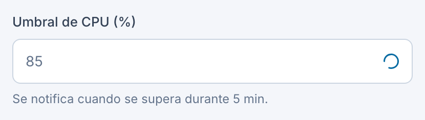</td></tr>
    <tr><th>Select (dropdown)</th><td>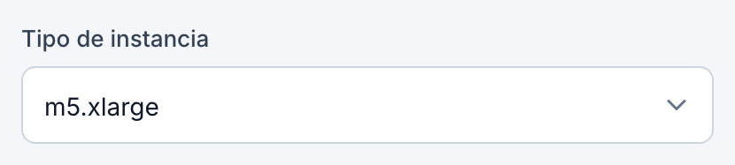</td><td>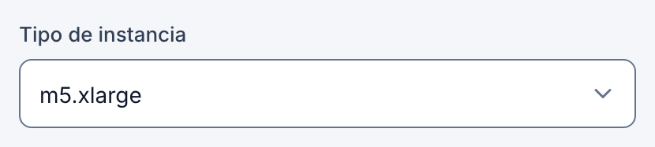</td><td>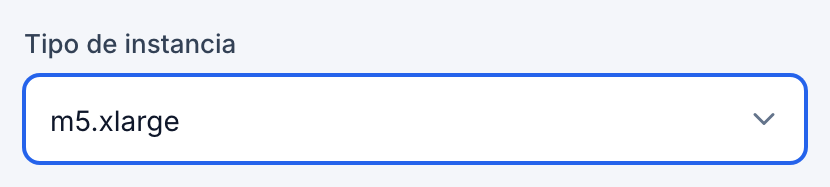</td><td>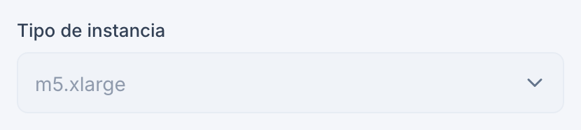</td><td>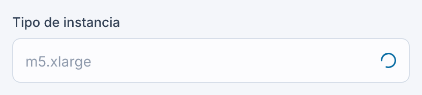</td></tr>
    <tr><th>Selector de fecha</th><td>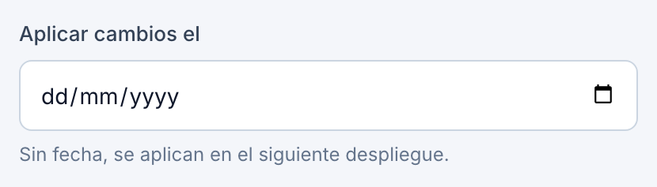</td><td>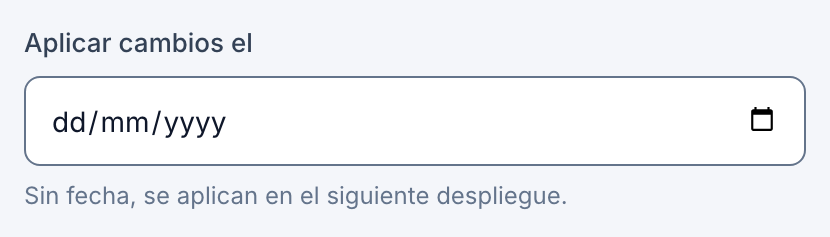</td><td>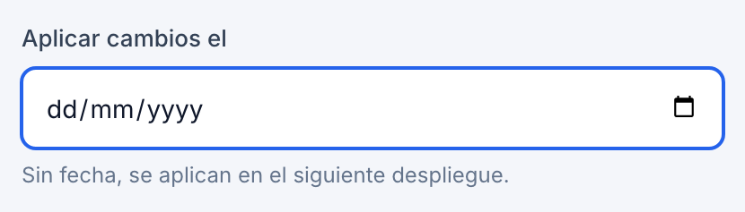</td><td>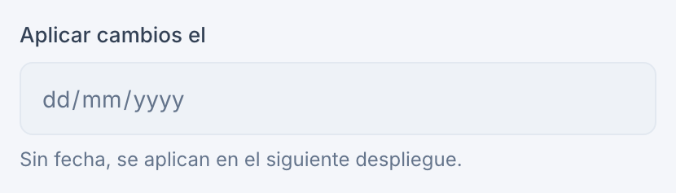</td><td>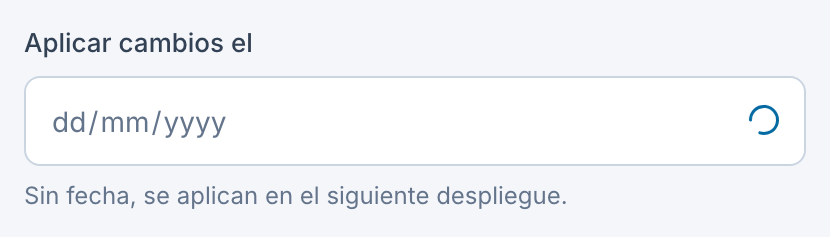</td></tr>
    <tr><th>Área de texto</th><td>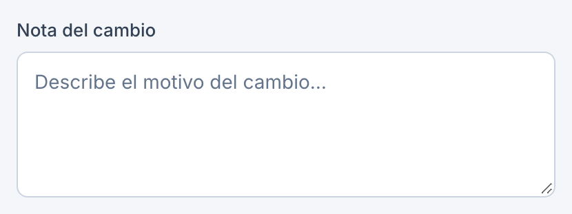</td><td></td><td></td><td></td><td></td></tr>
    <tr><th>Interruptor</th><td></td><td></td><td></td><td></td><td></td></tr>
    <tr><th>Opción segmentada (1 h)</th><td></td><td></td><td></td><td></td><td></td></tr>
    <tr><th>Elemento de navegación</th><td></td><td></td><td></td><td></td><td></td></tr>
    <tr><th>Búsqueda</th><td></td><td></td><td></td><td></td><td></td></tr>
    <tr><th>Toggle de modo oscuro</th><td></td><td></td><td></td><td></td><td></td></tr>
    <tr><th>Pestaña (Eventos)</th><td></td><td></td><td></td><td></td><td></td></tr>
  </tbody>
</table>

### Modo oscuro

<table>
  <thead><tr><th>Control</th><th>Default</th><th>Hover</th><th>Focus</th><th>Disabled</th><th>Loading</th></tr></thead>
  <tbody>
    <tr><th>Botón primario</th><td></td><td></td><td></td><td></td><td></td></tr>
    <tr><th>Botón secundario</th><td></td><td></td><td></td><td></td><td></td></tr>
    <tr><th>Botón fantasma</th><td></td><td></td><td></td><td></td><td></td></tr>
    <tr><th>Botón de peligro</th><td></td><td></td><td></td><td></td><td></td></tr>
    <tr><th>Botón de peligro (contorno)</th><td></td><td></td><td></td><td></td><td></td></tr>
    <tr><th>Enlace con aspecto de botón</th><td></td><td></td><td></td><td></td><td></td></tr>
    <tr><th>Botón de ícono</th><td></td><td></td><td></td><td></td><td></td></tr>
    <tr><th>Campo de texto</th><td></td><td></td><td></td><td></td><td></td></tr>
    <tr><th>Select (dropdown)</th><td></td><td></td><td></td><td></td><td></td></tr>
    <tr><th>Selector de fecha</th><td></td><td></td><td></td><td></td><td></td></tr>
    <tr><th>Área de texto</th><td></td><td></td><td></td><td></td><td></td></tr>
    <tr><th>Interruptor</th><td></td><td></td><td></td><td></td><td></td></tr>
    <tr><th>Opción segmentada (1 h)</th><td></td><td></td><td></td><td></td><td></td></tr>
    <tr><th>Elemento de navegación</th><td></td><td></td><td></td><td></td><td></td></tr>
    <tr><th>Búsqueda</th><td></td><td></td><td></td><td></td><td></td></tr>
    <tr><th>Toggle de modo oscuro</th><td></td><td></td><td></td><td></td><td></td></tr>
    <tr><th>Pestaña (Eventos)</th><td></td><td></td><td></td><td></td><td></td></tr>
  </tbody>
</table>
